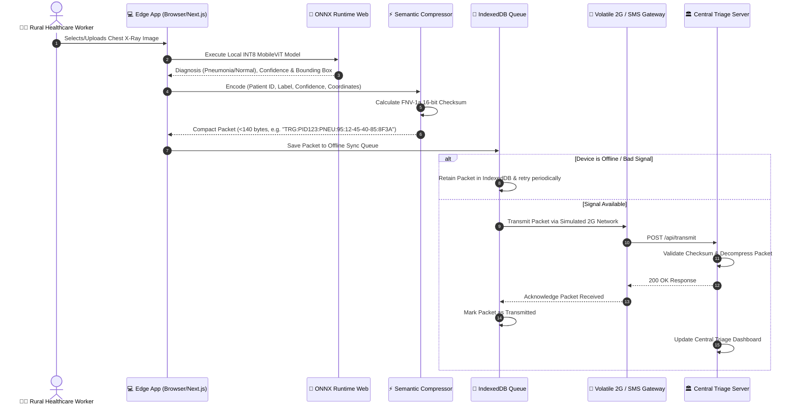

# 🩺 EdgeTriage Medical AI System

> **Offline-First Edge AI Chest X-Ray Triage & Low-Bandwidth Transmission System for Remote & Rural Healthcare**

EdgeTriage is an end-to-end medical AI solution designed for low-resource health clinics operating in remote regions with unreliable or non-existent internet connectivity. By combining browser-based Vision Transformer (MobileViT) ONNX inference, semantic data compression, offline queue management, and secure low-bandwidth transmission protocols (SMS/<140 bytes), EdgeTriage enables immediate diagnostic assistance at the edge without requiring active cloud connectivity.

---

## 🏗️ System Architecture Diagram

```mermaid
flowchart TD
    subgraph EdgeDevice ["📱 Edge Device (Clinic Web App / Browser)"]
        direction TB
        UI["🖥️ Next.js Web UI & Canvas Handler"]
        ML_ENGINE["🧠 ONNX Runtime Web (WASM / WebGL)"]
        MODEL["📦 INT8 Quantized MobileViT Model (model_quantized.onnx)"]
        CANVAS["🔍 Visual Heatmap & Bounding Box Extractor"]
        COMPRESS["⚡ Semantic Compression Engine (<140 Bytes SMS Payload)"]
        HASH["🔒 16-Bit FNV-1a Checksum Generator"]
        QUEUE["💾 Offline Storage & IndexedDB Queue"]
        RETRY["🔄 Network Dispatcher & Exponential Backoff"]

        UI -->|Input Chest X-Ray| ML_ENGINE
        MODEL -->|Load Model| ML_ENGINE
        ML_ENGINE -->|Classify (Normal vs Pneumonia)| CANVAS
        CANVAS -->|Extract Bounding Box & Confidence| COMPRESS
        COMPRESS --> HASH
        HASH -->|Assemble SMS Packet| QUEUE
        QUEUE --> RETRY
    end

    subgraph Network ["📡 Low-Bandwidth Channel (Simulated 2G / SMS)"]
        SMS_NET["📶 Volatile 2G / SMS Cellular Gateway"]
        RETRY -->|Transmit Packet| SMS_NET
    end

    subgraph CentralServer ["🏛️ Central Hospital Gateway & Triage Server"]
        API["📡 Next.js API Gateway (/api/transmit)"]
        VERIFY["✔️ Checksum & Payload Integrity Verifier"]
        DECOMPRESS["🔓 Semantic Decompression Engine"]
        SECURE["🔐 AES Cryptographic Decryptor"]
        DASHBOARD["📊 Telemetry & Central Triage Dashboard"]

        SMS_NET -->|HTTP / SMS Post| API
        API --> VERIFY
        VERIFY -->|Valid Payload| DECOMPRESS
        VERIFY -->|Encrypted Payload| SECURE
        SECURE --> DECOMPRESS
        DECOMPRESS --> DASHBOARD
    end
```

---

## 🔄 Flow of Working



### Detailed Operational Lifecycle

1. **Image Input & Edge Preprocessing**:
   - The clinic worker uploads or captures a Chest X-Ray image within the offline-capable web interface.
   - The browser normalizes and resizes the image tensor to `224x224x3` without sending any image data over the network.

2. **In-Browser Local Model Inference**:
   - Inference runs locally on the edge device using `onnxruntime-web` with WebAssembly/WebGL hardware acceleration.
   - The INT8 quantized **MobileViT** (Vision Transformer) model evaluates the image, outputting class probabilities (`Normal` vs `Pneumonia`) and anomaly localization coordinates.

3. **Semantic Payload Compression (< 140 Bytes)**:
   - Inference results are packed into a compact SMS-compatible ASCII string format:
     `TRG:<PatientID>:<Diagnosis>:<Confidence>:<BoundingBox>:<Checksum>`
   - A 16-bit **FNV-1a checksum** is appended to protect against transmission bit rot and packet corruption.

4. **Offline Queueing & Network Simulation**:
   - If connectivity is degraded or offline, the packet is stored in browser **IndexedDB**.
   - A background queue dispatcher monitors network status and handles automatic re-transmissions using **exponential backoff and jitter**.
   - The built-in 2G simulator tests system resilience against latency spikes, packet drops, and low bandwidth.

5. **Central Gateway Receipt & Decompression**:
   - The central server receives compressed transmission payloads via `/api/transmit`.
   - The server verifies the FNV-1a checksum, decompresses the payload back into structured JSON metrics, and populates the central triage telemetry dashboard.

---

## ⭐ Key Features

| Feature | Description |
| :--- | :--- |
| **🧠 Zero-Cloud Edge AI** | Runs fine-tuned **MobileViT Vision Transformer** models directly in the browser via ONNX Runtime Web (WASM/WebGL). No active internet required for diagnostic inference. |
| **⚡ SMS Semantic Compression** | Compresses diagnosis, confidence scores, and bounding box coordinates into sub-140-byte payloads compatible with legacy SMS channels. |
| **🔒 Data Integrity & Checksumming** | Integrates an **FNV-1a 16-bit checksum** into every packet for fast, low-overhead integrity verification at the receiving gateway. |
| **🔐 Secure Cryptographic Payloads** | Supports optional AES-encrypted, base64-encoded payload transmission for sensitive patient metadata protection over unencrypted networks. |
| **💾 IndexedDB Offline Resilience** | Retains pending triage submissions in local browser storage during internet outages and auto-flushes upon connection restoration. |
| **📡 Volatile 2G Network Simulator** | Emulates real-world rural connectivity constraints (latency, packet loss, bandwidth caps, retry logic with exponential backoff). |
| **🌐 Multilingual i18n UI** | Instant locale switching between **English, Spanish, French, Swahili, and Hindi** to empower rural healthcare workers globally. |
| **🤖 Full ML Pipeline Included** | Production-ready Python script (`ml_pipeline.py`) to fine-tune Hugging Face Vision Transformers and export INT8 quantized ONNX binaries. |

---

## 📂 Folder Structure

```
HEALTH_TRIAGE/
├── app/                        # Next.js App Router Application
│   ├── api/                    # Server-side API Endpoints
│   │   └── transmit/           # Triage Data Transmission Gateway
│   │       └── route.ts        # POST endpoint verifying checksums & decompressing SMS packets
│   ├── favicon.ico             # Application Favicon
│   ├── globals.css             # Design System, Glassmorphism, animations & styles
│   ├── layout.tsx              # Root HTML Layout with theme & metadata
│   └── page.tsx                # Main EdgeTriage Dashboard (UI, Canvas, Inference, Queue & Simulator)
│
├── dictionaries/               # Internationalization (i18n) Translations
│   ├── en.json                 # English dictionary
│   ├── es.json                 # Spanish dictionary
│   ├── fr.json                 # French dictionary
│   ├── hi.json                 # Hindi dictionary
│   └── sw.json                 # Swahili dictionary
│
├── lib/                        # Core Application Libraries & Engines
│   ├── compression.ts          # Semantic SMS encoding/decoding & FNV-1a checksum calculation
│   ├── i18n.ts                 # Translation dictionary loader & helper functions
│   ├── inference.ts            # ONNX Runtime Web wrapper & image tensor pre/post-processing
│   ├── offlineQueue.ts         # IndexedDB queue management & backoff retry dispatcher
│   └── securePayload.ts        # AES payload encryption, decryption & checksum signing
│
├── model_finetuned/            # Fine-tuned PyTorch Model Artifacts (Generated by ml_pipeline.py)
├── model_onnx/                 # Unquantized ONNX Model Export (Generated by ml_pipeline.py)
├── model_quantized_dir/        # Intermediate ONNX Quantization Output
├── model_quantized.onnx        # Final INT8 Quantized MobileViT Model (~5.6MB) for Browser Deployment
├── public/                     # Static Web Assets (Icons, Images, WASM binaries)
├── vit_results/                # Fine-tuning Checkpoints & PyTorch Trainer Outputs
│
├── ml_pipeline.py              # Machine Learning Pipeline (PyTorch -> Hugging Face -> ONNX INT8 Quantization)
├── next.config.ts              # Next.js Server & Webpack Configurations (WASM & Web Workers enabled)
├── package.json                # Node.js Dependencies and Scripts
├── tsconfig.json               # TypeScript Compiler Configuration
├── eslint.config.mjs           # ESLint Linting Rules
└── README.md                   # System Architecture & Documentation
```

---

## 🛠️ Getting Started & Installation

### Prerequisites

- **Node.js**: `v18.x` or higher
- **npm** / **yarn** / **pnpm**
- **Python**: `v3.10+` (Only required if running the ML model fine-tuning pipeline)

### 1. Web Application Setup

1. **Clone the repository**:
   ```bash
   git clone https://github.com/your-org/edge-triage.git
   cd edge-triage
   ```

2. **Install dependencies**:
   ```bash
   npm install
   ```

3. **Start the development server**:
   ```bash
   npm run dev
   ```

4. **Open in Browser**:
   Navigate to [http://localhost:3000](http://localhost:3000) to access the EdgeTriage application.

---

### 2. Machine Learning Pipeline (Fine-Tuning & Quantization)

To train or re-quantize the MobileViT vision model locally:

1. **Install Python requirements**:
   ```bash
   pip install torch torchvision transformers datasets optimum[onnxruntime] pillow numpy
   ```

2. **Execute the pipeline script**:
   ```bash
   python ml_pipeline.py
   ```

   This script will:
   - Load `apple/mobilevit-small`.
   - Fine-tune on binary chest X-ray classification.
   - Export to ONNX format.
   - Quantize to INT8 (`model_quantized.onnx`), shrinking the model to **~5.6 MB** for fast browser load times.

---

## 📜 License

This project is open-source under the [MIT License](LICENSE).
